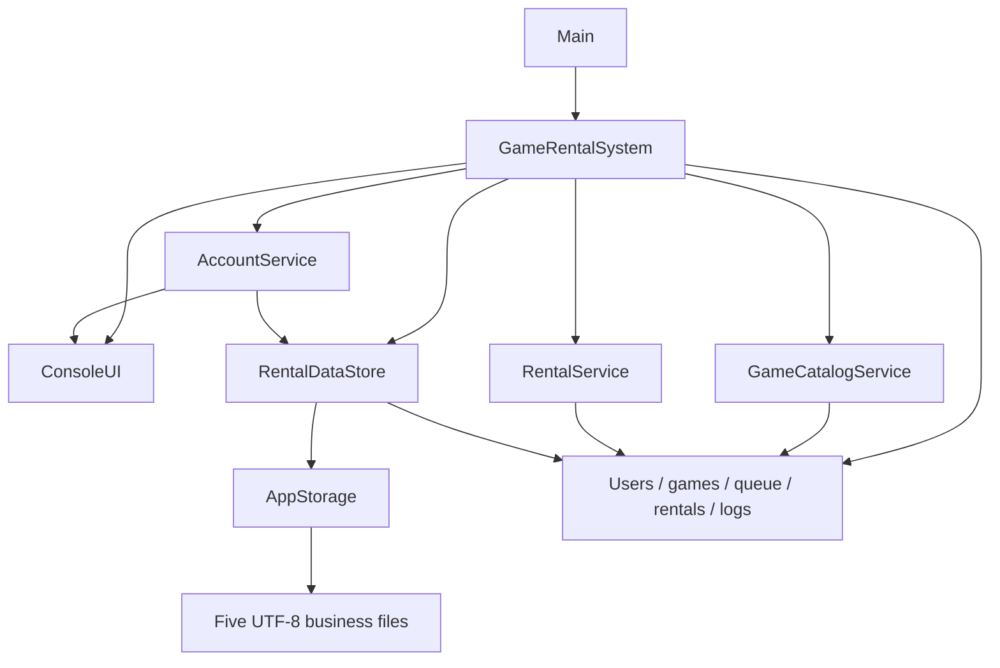
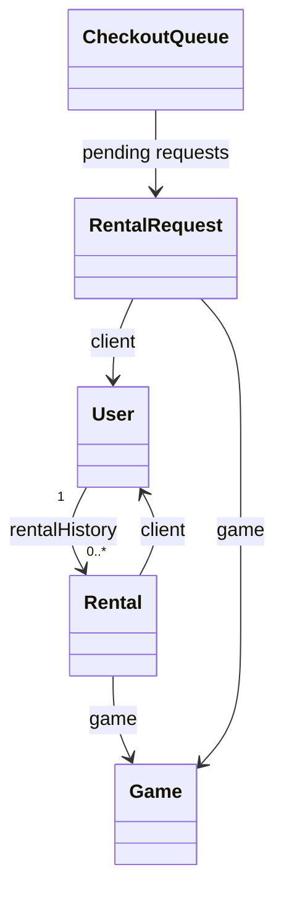

# Queue2Play — Detailed Project Analysis and Overview

Analysis date: October 10, 2026 (Asia/Ulaanbaatar).

Scope: the complete supplied project folder, including all 16 Java source files, the PowerShell launcher, five live data files, five backup files, and the data lock file. This is a descriptive analysis, not a change proposal being implemented. No application source, launcher, account, inventory, rental, queue, log, or backup file was edited. The only project addition is this report under `.skills/`.

Method: static source inspection and read-only inspection of saved data. The application was not launched: constructing storage can create directories, acquire/create a lock, and recover a journal; startup can restore embedded accounts and save data. No compilation or behavioral test suite was run. Runtime behavior described below is established from source, not an executed end-to-end demonstration. A read-only Java version probe did not complete and was interrupted; the installed JDK version is unverified.

## Contents

1. Project purpose and scope
2. Project inventory and component responsibilities
3. Architecture and object relationships
4. Features and user workflows
5. Business rules and calculations
6. Data structures and algorithms
7. Persistence formats and current saved state
8. Save transactions, recovery, and rollback
9. Authentication and validation
10. Console presentation and platform behavior
11. Build and runtime configuration
12. Findings, limitations, and maintenance considerations
13. Verification boundaries and suggested future checks
14. Reference map

## 1. Project purpose and scope

Queue2Play is a local, interactive Java console application for managing physical game rentals. Clients browse a catalog, submit requests to a checkout queue, cancel their pending requests, inspect rental history, and upgrade to VIP membership. Administrators approve queued requests, record returns and late fees, manage inventory, and inspect active rentals and administrative activity.

The catalog supports three exact platform labels: `PS5`, `Xbox`, and `Nintendo`. The application models available copies and rented quantities. It does not model individual discs or uniquely identified physical copies.

The supplied implementation uses Java standard-library collections, a custom doubly linked queue, and UTF-8 text storage. There is no server, browser frontend, network API, relational database, external Java dependency, payment processor, or scheduled overdue notification service in the supplied files.

Its explicit use of linear search, insertion sort, stacks, a min-heap, and a linked queue suggests an educational data-structures project. That purpose is an inference from implementation and comments; no assignment specification was supplied.

## 2. Project inventory and component responsibilities

The Java sources contain 4,934 lines, including comments and blank lines. All classes are in the default package. There is no Maven/Gradle descriptor, README, automated test source, CI configuration, or Git repository in the supplied directory. No applicable `AGENTS.md` was found in the project or its immediate parent.

| File | Lines | Responsibility |
|---|---:|---|
| `Main.java` | 13 | Entry point; starts the system; handles input termination and top-level storage/argument errors. |
| `GameRentalSystem.java` | 1,614 | Owns shared state, constants, menus, cart workflow, administrative transactions, pagination, and service wiring. |
| `ConsoleUI.java` | 1,522 | Terminal rendering, menu/table layouts, input guides, validation messages, password input, colors, artwork, and pauses. |
| `AccountService.java` | 335 | Loads and restores accounts; registration; username/email lookup; login; account persistence delegation. |
| `GameCatalogService.java` | 158 | Catalog validation, platform IDs, seed games, filtering, search, and insertion sort. |
| `RentalService.java` | 212 | Stock calculations, rental prices, cart/checkout validation, checkout mutation, overdue calculations, and returns. |
| `CheckoutQueue.java` | 222 | Custom doubly linked request queue, priority ordering, fairness streak, lookup, removal, and eligible request selection. |
| `RentalDataStore.java` | 479 | Parses and serializes business files, validates relationships, loads logs, and restores committed in-memory snapshots. |
| `AppStorage.java` | 191 | Data-directory resolution, file locks, byte-level conflict detection, backups, journal commits, and recovery. |
| `Passwords.java` | 73 | PBKDF2 password creation, encoded-hash validation, and password verification. |
| `Game.java` | 21 | Game record and availability predicate. |
| `User.java` | 33 | Account record, membership/role helpers, and rental history stack. |
| `RentalRequest.java` | 17 | Pending game request with client, queue number, VIP flag, duration, and quantity. |
| `Rental.java` | 33 | Rental/return record and earliest-due comparison. |
| `InputEndedException.java` | 4 | Signals terminated input without submitting unfinished input. |
| `StorageException.java` | 7 | Represents persistence/startup failures with an optional underlying cause. |
| `run.ps1` | — | Compiles every root Java file into `.build`, configures UTF-8, and launches `Main` with an explicit data directory. |
| `data/` | — | Live text data, first preserved backups, and `.lock`. |

`GameRentalSystem` and `ConsoleUI` together account for about 64% of Java source lines. Most project complexity therefore lies in interaction and presentation, rather than the domain records.

## 3. Architecture and object relationships



`GameRentalSystem` constructs services around shared mutable collections. This matters: account and catalog services retain references to the same collections that the datastore later clears and repopulates during rollback. Restoring state does not replace those collection objects.

The main state consists of:

- `games`: declared as `HashMap<String, Game>`, instantiated as `LinkedHashMap`, preserving inventory insertion order.
- `users`: an `ArrayList<User>` with case-insensitive account searches.
- `checkoutQueue`: the custom pending request queue.
- `activeRentals`: a `PriorityQueue<Rental>` ordered by due time, then rental number.
- `allRentals`: an `ArrayList<Rental>` containing active and completed records.
- `auditLog`: a `Stack<String>` of administrative actions.
- `logRecords`: an `ArrayList<String>` of all stored event and admin records.
- Incrementing queue/rental numbers, platform ID counters, and a dashboard-navigation flag.

Object relationships:



Domain fields are mutable and package-visible. The controller performs some transactions directly, while `RentalService` handles checkout and return mutations. Services are a useful separation, but authorization, navigation, and business orchestration remain coupled to the console controller.

### Startup sequence

1. `Main` constructs `GameRentalSystem`; `RentalDataStore` constructs `AppStorage`.
2. Storage resolves/creates the data directory, briefly locks it, recovers a journal if present, optionally imports a legacy flat-file layout, and remembers original bytes.
3. `start()` loads accounts, games, rentals, queue, then logs.
4. A committed in-memory checkpoint is recorded.
5. The system saves if embedded accounts changed or any of accounts/games/rentals/queue is missing.
6. The public menu loops until exit, routing a successful login to the appropriate role dashboard.

Only a missing `games.txt` triggers the nine-game seed catalog; an existing empty game file is not automatically reseeded. Missing accounts trigger restoration of embedded accounts. Missing rental/queue files produce empty collections.

## 4. Features and user workflows

### Public access

The public menu offers login, registration, and exit. Registration collects full name, username, email, password, password confirmation, then an explicit account confirmation. Users can go back, edit, or cancel before account creation. New accounts are `CLIENT` / `REGULAR`.

Login accepts either username or email, with case-insensitive lookup. Successful login, unknown identifiers, and incorrect passwords generate saved event records. Logout returns to the public menu; there is no persistent session token.

### Client dashboard

| Option | Behavior |
|---|---|
| Browse inventory | View all games or one platform; search; sort. |
| Rent games / join checkout queue | Assemble a cart, choose quantities and duration, review/edit, and submit. |
| My queue requests | Display the client's pending requests and cancel individual requests. |
| Rental history | Display active and completed rentals, newest rental number first. |
| Upgrade to VIP | Free membership upgrade; updates pending request priority. |
| Logout | Confirmation, then return to public menu. |

Cart selection uses `LinkedHashMap<Game, Integer>` so order lines retain selection order. Re-adding a game increments its cart quantity. Editing can add games, remove an entire line, or change the common duration. There is no dedicated decrement-one-copy edit operation.

A confirmed multi-game cart becomes one separate `RentalRequest` per game. All lines are saved together at submission, but later checkout approval is per request. There is no persistent cart, order header, shared order ID, or guarantee that all lines receive approval together.

Requests are accepted even if stock is zero or below the requested quantity. Joining the queue does not deduct stock. The interface explicitly explains that stock is checked at checkout.

Clients cannot submit another pending request or hold another active rental for the same game ID. Different platform versions of a title have distinct IDs and are separate games under these rules.

### Administrator dashboard

| Area | Operations |
|---|---|
| Checkout management | View all pending requests; process next eligible request; cancel any request by number. |
| Returns | Select an active rental; preview return/fee details; confirm the full quantity return. |
| Inventory | Browse; add a game; increase/decrease available stock; delete a game. |
| Active rentals | View all active rentals or only overdue rentals, ordered earliest due first. |
| Admin audit log | View newest administrative actions first. |

Checkout approval creates an `ACTIVE` rental, computes its price using current membership, deducts the requested stock, pushes client history, adds the active heap entry, updates the VIP streak, removes the pending request, logs the action, and saves the complete state.

Returns restore all copies in the rental line, remove the active heap entry, mark the record `COMPLETED`, and save the return timestamp, overdue days, and late fee. Partial returns and extensions are not implemented. Payment collection is explicitly separate.

Inventory addition rejects a duplicate title on the same platform, ignoring title case. The same title on another platform is allowed. There is no title/platform/price editing screen after creation.

Deletion is blocked while a game has any active rental. If only pending requests exist, deletion warns that they will be canceled, removes those requests, and saves the combined changes. Completed rental history is retained; loading can construct a historical game object for a deleted title.

## 5. Business rules and calculations

| Rule | Implemented value/behavior |
|---|---|
| Base rental period | 3 days. |
| Requested duration | 1–30 days; shortcuts for 1, 3, and 7 days. |
| Quantity per game request/rental | 1–5 copies. |
| Total stock per game | Available copies + active rented copies must be at most 20. |
| Catalog price | Finite numeric value from $1.00 to $10.00, representing the three-day base price. |
| New-game UI stock | 1–20; loaded/service-valid available stock can be 0–20. |
| VIP discount | 10% of base rental price. |
| VIP membership charge | Free project membership; no payment operation. |
| Late fee | $1 per copy per started 24-hour period overdue. |
| Queue fairness | Prefer an eligible regular request after 3 consecutive VIP checkouts. |
| Due time | Actual checkout timestamp plus requested days. |
| Pricing time | At checkout, from current membership and game price. |

Rental calculation:

```text
discountedBase = game.price × (VIP ? 0.90 : 1.00)
unitCharge    = roundToCents(discountedBase × requestedDays / 3)
lineCharge    = roundToCents(unitCharge × quantity)
```

Example: a $5.00 game for 7 days costs $11.67 per regular copy, or $10.50 per VIP copy. Two regular copies cost $23.34 because unit price is rounded before multiplication. Rounding only the unrounded two-copy total would yield $23.33; that is a different policy from this implementation.

Overdue calculation:

```text
if returnedAt <= dueDate: daysLate = 0
else: daysLate = ceiling(elapsed overdue duration / 24 hours)
lateFee = daysLate × $1.00 × quantity
```

One second late incurs one overdue day. Exactly 24 hours late is one day; 24 hours plus a positive fraction is two days. VIP discount is not applied to late fees. No tax, deposit, fee cap, or payment balance is modeled.

Times use `LocalDateTime.now()` from the machine's local clock. Storage has no timezone/UTC offset. These are local timestamps, not globally unambiguous instants.

## 6. Data structures and algorithms

Let G = catalog games, U = users, Q = pending requests, A = active rentals, and R = all rental records. Costs below describe the relevant collection operations; file saving adds whole-state work.

| Structure/algorithm | Use | Typical cost |
|---|---|---|
| LinkedHashMap | ID lookup and stable catalog order | Average O(1) ID lookup; O(G) filtering. |
| ArrayList of users | Username/email lookup | O(U). |
| LinkedHashMap cart | Stable game selection order | Average O(1) line update. |
| Custom doubly linked queue | Pending priority groups | Regular enqueue O(1); VIP insertion O(Q); searches/removal-by-request O(Q). |
| Queue eligibility scan | Find an adequately stocked request | O(Q), with up to two scans when fairness applies. |
| PriorityQueue | Active rental due ordering | O(log A) insertion; O(1) earliest peek; arbitrary removal/contains O(A). |
| Heap copy and polling | Fully ordered active-rental display | O(A log A), preserving live heap. |
| Stack | Client history and admin audit | O(1) push; O(number of records) reverse display copy. |
| Linear search | Exact ID/platform or title substring | O(G), aside from string processing. |
| Insertion sort | Title A–Z/Z–A; price ascending/descending | O(G²) worst case; O(G) already ordered best case. |

The linked queue stores VIP requests before regular requests while retaining FIFO within each group. VIP enqueue scans past existing VIP nodes and inserts before the first regular. Unlinking updates both previous/next links and front/rear pointers.

Scheduling differs from list order: `findNextEligibleRequest()` skips requests without enough stock. After three consecutive VIP approvals, it first scans for an adequately stocked regular request; if none exists, it can continue serving VIP requests. A regular checkout resets the streak; cancellation does not count as a checkout. Therefore the fairness rule is conditional on stock availability, not a strict global one-in-four reservation.

Upgrading a client refreshes their requests' VIP flags, sorts requests by queue number, and rebuilds priority groups. Loading also sorts requests by queue number and derives VIP status from the current user account, rather than trusting the persisted flag's value. The flag is checked for valid boolean syntax.

`Rental.compareTo()` uses due date and then rental number for deterministic ties. Iterating Java's heap directly would not produce sorted output; the service correctly copies and polls it for display.

Load-time history reconstruction loops through all rentals for each user, approximately O(U × R). State validation also scans active rentals repeatedly for stock and conflicts. The current small dataset fits these choices, but growth increases costs.

## 7. Persistence formats and current saved state

All five live business files use UTF-8, pipe-separated fields, and comment headers. Empty lines and ordinary `#` comments are skipped; `#COUNTERS` rows remain meaningful. Fields are not CSV-quoted or generally escaped. Input restrictions protect delimiters in structured fields; log parsing uses a three-part split so message pipes can remain in the final field.

| File | Current record format |
|---|---|
| `accounts.txt` | `username|fullName|email|passwordHash|role|membership` |
| `games.txt` | `gameId|title|platform|price|availableCopies` |
| `rentals.txt` | `number|username|gameId|title|platform|checkoutDate|dueDate|amount|status|quantity|returnDate|daysLate|lateFee` |
| `queue.txt` | `number|username|gameId|vip|rentalDays|quantity` |
| `logs.txt` | `yyyy-MM-dd HH:mm:ss|type|message` |

Metadata:

- Games: `#COUNTERS|ps5Counter|xboxCounter|nintendoCounter`.
- Rentals: `#COUNTERS|nextRentalNumber`.
- Queue: `#COUNTERS|nextQueueNumber|vipStreak`.

Rental dates serialize through `LocalDateTime.toString()`, so ISO timestamps can contain seconds and fractional seconds. Legacy date-only values load as start-of-day for checkout and 23:59 for due date. Rental loaders accept 9-, 10-, and 13-field layouts; older missing quantity defaults to one. Queue loaders accept 4–6 fields; missing duration defaults to three and missing quantity to one. A legacy queue counter can omit VIP streak.

Game IDs use `P`, `X`, or `N` plus a minimum three-digit number, such as `P001`. Counters advance per platform and survive normal save/reload, including deletions. Queue and rental display numbers use a minimum three-digit format, not a fixed three-digit capacity.

### Saved dataset at inspection

| Item | Observed state |
|---|---|
| Accounts | 4: one admin, three clients; one VIP client. |
| Current account passwords | All four stored values use the PBKDF2 encoding. Hash material is omitted from this report. |
| Catalog | 10 games: 3 PS5, 4 Xbox, 3 Nintendo. |
| Available copies | 17 total; no active rentals. |
| Rental records | 0; next rental number 1. |
| Pending requests | 0; next queue number 1; VIP streak 0. |
| Log records | 8: 7 EVENT, 1 ADMIN. |
| Recorded log range | October 8, 2026, 21:02:53–23:32:06, in stored local time. |
| Transaction journal | No `.transaction` directory present. |
| Lock file | `.lock` exists and is empty; existence alone does not establish an active process lock. |

The catalog contains the nine seed titles plus `X004`, titled `test`, priced at $6.00 with five available copies. The seed catalog is Spider-Man 2, Minecraft, God of War, Halo Infinite, Forza Horizon 5, Minecraft on Xbox, Mario Kart 8, Zelda: Tears of the Kingdom, and Animal Crossing.

The account backup contains three older plaintext password values; the live account file contains hashes. Backup content was inspected without reproducing passwords. Other backups retain the earlier nine-game catalog, empty legacy rental/queue files, and two event logs. These are historical copies, not automatically updated mirrors of the current state.

## 8. Save transactions, recovery, and rollback

Every save helper (`saveAccounts`, `saveGames`, `saveQueue`, `saveRentals`) ultimately saves all five business files. Even logging a failed login rewrites the complete business-file set.

### Commit protocol

1. `RentalDataStore.serialized()` validates state and builds all five outputs.
2. `AppStorage.commit()` briefly acquires the data-directory lock and recovers any journal.
3. It compares each live file byte-for-byte with the bytes remembered by this session. External changes cause rejection with a restart/reload message.
4. It creates `.transaction` and writes existing bytes to known `.old` files and proposed bytes to `.new` files, forcing file channels to disk.
5. It preserves each first `.bak` if that backup does not already exist.
6. It writes a `prepared` marker listing previously existing files.
7. It replaces each live file, requesting an atomic move with an ordinary replacement fallback.
8. It writes `committed`, refreshes remembered bytes, and attempts journal cleanup.
9. The datastore records a new in-memory checkpoint.

Before `prepared`, interrupted work is discarded by journal cleanup. With `prepared` but no `committed`, recovery restores all old files and removes files that did not previously exist. With `committed`, recovery keeps the new state and cleans up the journal.

This is a recoverable multi-file protocol, not a single atomic database transaction. Locks are held during storage opening/committing/recovery, not throughout the interactive session. Two sessions can open the same directory at different times; the first successful write makes the other's remembered bytes stale, so its subsequent save should be rejected.

### In-memory rollback

If `saveData()` throws a runtime exception, a previously recorded snapshot restores collections, stocks, membership/password values, rental return fields, request priorities, logs, IDs, counters, and VIP streak. Rental history and the active heap are reconstructed.

The snapshot targets currently implemented mutations. It does not copy every possible mutable field: for example, existing game title/price changes and account name/email/role edits would need additional rollback handling if those features were later added.

Failure injection hooks exist for future tests:

- `q2p.test.failAfterReplace`: throw an I/O failure after replacing a specified file count.
- `q2p.test.crashAfterReplace`: halt with exit code 91 after a specified file count.

These hooks were not exercised. The design improves recoverability, but power-loss durability and filesystem-specific behavior have not been demonstrated by this analysis.

## 9. Authentication and validation

Passwords are encoded as `pbkdf2$iterations$base64Salt$base64DerivedKey`. New hashes use PBKDF2-HMAC-SHA256, 210,000 iterations, a random 16-byte salt, and a 256-bit derived key. Encoded hashes must contain four fields, 100,000–1,000,000 iterations, a 16-byte decoded salt, and a 32-byte decoded key. Verification uses `MessageDigest.isEqual()` on derived bytes. These are implementation facts, not a certification against current security standards.

The `User` constructor preserves a valid encoded hash, or hashes a supplied plaintext value. This supports loading older plaintext accounts. A later save serializes hashes. Salt/iteration rehash upgrades are not automatically performed for every valid older hash.

Input validation includes:

- Username: 3–32 ASCII letters, digits, dots, underscores, or hyphens.
- Full name: 2–100 characters; starts with a Unicode letter; remaining characters may include letters, combining marks, spaces, dots, apostrophes, and hyphens.
- Email: at most 254 characters and a basic pattern with an alphabetic suffix of at least two letters; no ownership verification.
- Password: registration requires at least eight characters and excludes `|`; no maximum length or complexity policy.
- Game title: nonblank, at most 100 characters, no `|`, no ISO control characters.
- Game price/amounts: finite numbers with domain-specific limits.
- Roles/memberships/platforms/statuses: exact recognized strings.
- IDs and counters: constrained positive integer ranges and platform-specific prefixes.
- Rental/queue references: valid clients and canonical live games where required, no duplicate active or pending client/game pair.
- Active rentals: require active-heap membership and no completed-return fields.
- Loaded return fees: must agree with return time, overdue-day calculation, and quantity.

Malformed structured records produce file/line diagnostics. Logs receive lighter validation: loading checks a three-part structure, but does not enforce a timestamp format or fixed event types. Admin display handles unparseable legacy timestamps.

Authorization is enforced primarily by menu routing: admin accounts reach admin workflows, and registration creates clients. This is not a reusable service-layer access-control boundary. Anyone with write access to local data files can alter roles and records; there are no signatures, encryption, or remote identity checks.

## 10. Console presentation and platform behavior

The interface uses pink Unicode borders and artwork, styled status words, dedicated input panels, message boxes, and fixed-width tables. It converts plain layout strings to box-drawing characters and delays border output to select appropriate corners/junctions.

Errors and warnings are deferred until the next input panel or pause; success messages print immediately. Screen clearing emits 60 blank lines rather than erasing terminal scrollback. Pauses and animated loading dots are presentation delays.

Default terminal width is 120, optionally read from `COLUMNS`, with a minimum of 40. Wide lines are split into fixed-width substrings; this prevents a single oversized line but does not preserve table columns on narrow terminals. String length calculations use Java character length rather than terminal display-cell width, so some Unicode names can affect alignment.

Pagination: games 9 rows, history/active/overdue 3 rows, audit 9 rows, return selection 10 rows. Pending queue and client request lists are not paginated. Navigation keys vary by screen: `0` goes back, `N/P` page, `S` searches, `C` cancels, and `M` returns toward the dashboard where implemented. They are not globally handled shortcuts.

On Windows, interactive text entry and password masking use a `powershell.exe` child process reading console keys. Password masking displays one asterisk per character. Base64 carries the result back to Java; it is transport encoding, not encryption. The scripts are static rather than interpolating the entered password into executable code.

On other operating systems, a real Java console supports hidden password entry. Without an interactive console on non-Windows platforms, password entry throws an argument error instead of reading an exposed password. Windows input depends on Windows PowerShell and an interactive terminal; redirected password input is unsuitable.

## 11. Build and runtime configuration

The intended launch command is `./run.ps1` from a PowerShell terminal in this folder. The script discovers root Java sources, creates `.build`, runs `javac -encoding UTF-8 -d .build`, then launches `Main` with UTF-8 properties and `q2p.dataDir` pointing to the project `data` folder. It reports nonzero compiler/program exits as errors.

Java 11 or later is inferred as the minimum source API level because the code uses `String.isBlank()` and `String.repeat()`; `List.of()` also requires a modern JDK. No explicit target/release level is set. The actual installed JDK and successful compilation were not verified.

| Setting | Purpose |
|---|---|
| `-Dq2p.dataDir=...` | Explicit storage directory; takes precedence over the environment variable. |
| `Q2P_DATA_DIR` | Storage directory when the property is absent. |
| Default storage | `data` next to compiled classes/code source; the launcher overrides this to the project data folder. |
| `-Dq2p.ascii=true` | Plain ASCII borders and simplified main menu. |
| `-Dq2p.color=false` / `NO_COLOR` | Disable ANSI coloring. |
| `-Dq2p.width=...` / `COLUMNS` | Terminal width, property preferred; minimum 40. |
| `-Dq2p.fast=true` | Disable pauses and loading animations. |
| `q2p.test.failAfterReplace` | Save failure injection. |
| `q2p.test.crashAfterReplace` | Process termination injection. |

The launch script has no parameter interface for the extra UI properties. A manually composed Java launch can supply them. Running the launcher would create build output and may update business data, so it was intentionally not run for this analysis.

## 12. Findings, limitations, and maintenance considerations

The following observations are grounded in inspected code. Suggested changes are analysis only and have not been applied.

### A. Embedded credentials are restored on every startup — high impact outside a demo

`AccountService.java:48–88` ensures the `admin`, `alex`, and `juan` accounts exist and restores their fixed identity/role/password details. This includes restoring a known administrator password if its stored value differs. Client VIP upgrades are retained, but administrator membership is normalized. Hashing live passwords therefore does not remove the known demo access path. If adapted for real use, first-run administrator setup and removal of forced credential resets would be priorities.

### B. Preserved account backups contain plaintext passwords

The inspected `accounts.txt.bak` contains three non-hashed password values. `AppStorage` only creates missing backups and intentionally does not refresh or sanitize them. Live-file hashing does not retroactively protect historical copies. Their preservation is useful for migration recovery, but they retain older sensitive content. No backup was changed or deleted.

### C. Return time is captured before user confirmation

`GameRentalSystem.java:1104` captures `returnedAt` before displaying confirmation, and that captured time is passed to `completeReturn`. If the operator waits across the due time or a started-day boundary, the recorded return time and fee use the earlier preview time. This is definite code behavior; it is only a policy error if the intended return time is the final confirmation instant.

### D. Recovery after a failed recovery needs a clear stopped state

In `AppStorage.commit`, a recovery failure is attached as a suppressed exception. Dashboard code catches `StorageException` and allows interaction to continue, while the message may require a restart. Filesystem failures severe enough to prevent rollback can leave uncertain on-disk state. A future design could explicitly prevent further mutations until successful recovery/reload. This failure scenario was not executed.

### E. Multi-file commits have a post-commit edge case

The `committed` marker is written before `rememberFiles()` reads the newly committed files. If that read fails, `commit()` throws, recovery recognizes the completed disk commit, and the datastore restores its earlier in-memory snapshot. Disk and memory could then describe different successful states. The ordering is visible in source; reproducing it would require an injected/read-permission failure and remains unverified.

### F. Currency and time choices need explicit policies for expanded use

Money uses `double`, unit-first rounding, and default-locale display formatting. Catalog prices are not restricted to two decimal places. Local timestamps have no offset and elapsed calculations use timezone-free `LocalDateTime`; clock changes or daylight-saving transitions can complicate real-world elapsed-time interpretation. These are manageable in a local demo but matter for accounting and deployment across locations.

### G. Login attempts have no throttling or lockout

The system logs wrong passwords and unknown accounts, but allows repeated attempts without a limit. It also distinguishes unknown identifiers from wrong passwords. Every attempt can trigger a complete file commit. This affects security and I/O volume if used beyond a trusted local environment.

### H. Whole-file storage and retained history limit scale

All history/logs stay in memory, every save serializes all records, and byte snapshots duplicate file content. There is no log rotation, archival, pagination of pending queues, or incremental storage. Repeated active-rental scans during validation add overhead. Existing algorithms are clear for the supplied dataset; a larger dataset would need performance evaluation.

### I. Cart-level business completion is intentionally partial

Submission saves cart lines together, but requests are approved/canceled independently. A displayed cart total is an estimate, not a persisted paid order total. A client upgrading after submission can receive the new VIP price at checkout. Stock can cause later list entries to be served first. These are implemented policies that should remain explicit to users.

### J. Queue priority is not guaranteed service order

Displayed positions reflect linked-list order. Fairness selection and stock eligibility can choose another position. A large quantity request can wait while smaller stocked requests proceed. No partial fulfillment, queue expiration, aging policy, or maximum queue length is implemented.

### K. Legacy historical IDs merit migration checks

Normal serialized catalog counters preserve deleted IDs. However, a legacy dataset lacking counters can contain completed rentals for deleted game IDs larger than current catalog IDs; `loadRentals()` does not advance platform counters from those historical IDs. A later added game could reuse such an ID and subsequent history loading could attach the record to the new live game. The supplied dataset has no rentals, so this is a potential legacy migration issue, not an observed corruption.

### L. Maintainability and authorization boundaries

The large controller contains both navigation state machines and business mutations; the large UI contains many fixed screen layouts. Shared package-visible state makes invariant enforcement dependent on disciplined callers. Snapshot coverage must evolve with new mutations. Domain methods do not take an authenticated administrator principal. Future API/GUI reuse would need clearer transaction and authorization boundaries.

### M. Error handling and metadata validation have uneven coverage

Interactive dashboard loops recover from storage failures but generally allow other argument/runtime failures to reach `Main` or escape its narrower catch. Number exhaustion during multi-line request creation is checked per line rather than preflighted for the whole cart. Logs have weaker validation than rental data; loaded completed legacy rentals can omit return timestamps. These distinctions matter when designing future fault handling and migration tests.

### Existing strengths

The project has explicit duplicate/reference checks, deterministic due-date tie-breaking, stock limits that include active rentals, fairer VIP scheduling, clear waiting-stock messaging, hidden password entry, salted password hashes, persisted counters, malformed-record diagnostics, external-change detection, journal recovery, and in-memory rollback for normal save failures. These features are materially more developed than a basic menu-only rental demo.

## 13. Verification boundaries and suggested future checks

Completed: source inspection of every component; inspection of live and historical storage layouts; comparison of persisted counters and dataset counts; tracing client/admin workflows and pricing/fee formulas; review of journaling and snapshot behavior. The only workspace write performed was adding this report. A SHA-256 baseline was attempted in temporary storage before writing the report, but that temporary manifest was unavailable in the later shell session, so an independent before/after hash comparison could not be completed.

Not completed: compiling, interactive UI testing, exercising failure hooks, load testing, actual journal crash recovery, cryptographic benchmarking, or filesystem durability testing. There is no supplied test suite. Zero saved rentals/requests means the provided data does not independently demonstrate those workflows.

If testing is later authorized, it should use a temporary copied dataset and build directory, covering:

1. Registration cancellation/backtracking, identifier collisions, hidden-password behavior, and legacy hash migration.
2. Queue FIFO within priority groups, the third-VIP boundary, no eligible regular request, stock skipping, membership upgrade, cancellation, and persistence of streak/counters.
3. Pricing across 1/3/7/30 days, 1–5 quantities, VIP membership, and unit-rounding boundaries.
4. Checkout stock conservation, active duplicates, full return, exact due instant, one second late, 24-hour boundaries, and confirmation delays.
5. Game deletion with active/completed/pending records; total-stock limits and historical ID preservation.
6. Save failure and process halt after each replacement position, followed by restart and verification of all five files and in-memory state.
7. Concurrent sessions, external edits, invalid records, legacy layouts, permissions failures, and post-commit read failures.
8. Narrow terminals, ASCII/no-color modes, Unicode names, Windows PowerShell input, and non-Windows console behavior.

These are recommendations for subsequent validation; no test files or changes were created.

## 14. Reference map

Paths below are relative to the project root and line numbers identify useful source entry points at the analyzed snapshot.

| Topic | Source entry point |
|---|---|
| Program startup/error handling | `Main.java:1`; `GameRentalSystem.java:88` |
| Constants and shared state | `GameRentalSystem.java:16` |
| Account validation/load/demo restoration | `AccountService.java:15`, `:33`, `:53` |
| Registration/login | `AccountService.java:116`, `:284` |
| Password hashing | `Passwords.java:8`, `:26`, `:36`, `:48` |
| Catalog IDs/seeding/search/sort | `GameCatalogService.java:49`, `:77`, `:100`, `:114` |
| Client menus/cart/submission | `GameRentalSystem.java:348`, `:438`, `:588`, `:678` |
| Queue priority/fairness | `CheckoutQueue.java:24`, `:49`, `:57`, `:194` |
| Pricing | `RentalService.java:52`, `:61`, `:67` |
| Checkout validation/mutation | `RentalService.java:99`, `:125`; `GameRentalSystem.java:981`, `:1036` |
| Returns/overdue | `RentalService.java:162`, `:171`; `GameRentalSystem.java:1097`, `:1183` |
| Admin audit/inventory | `GameRentalSystem.java:1232`, `:1281`, `:1313`, `:1480`, `:1522` |
| Serialization/invariants | `RentalDataStore.java:103`, `:144` |
| Rental/queue compatibility | `RentalDataStore.java:225`, `:302`, `:350` |
| Snapshot rollback | `RentalDataStore.java:391` |
| Storage location/recovery/commit | `AppStorage.java:16`, `:106`, `:125` |
| UI settings/input/rendering | `ConsoleUI.java:39`, `:54`, `:218`, `:263`, `:283`, `:301` |
| Launcher | `run.ps1` |

The project currently provides a cohesive local rental workflow with educational data structures and unusually extensive flat-file recovery logic. Its most consequential limitations for use beyond a demo are forced embedded credentials, plaintext historical backups, unverified failure edges, local-clock/currency policies, and the absence of executed automated verification.
